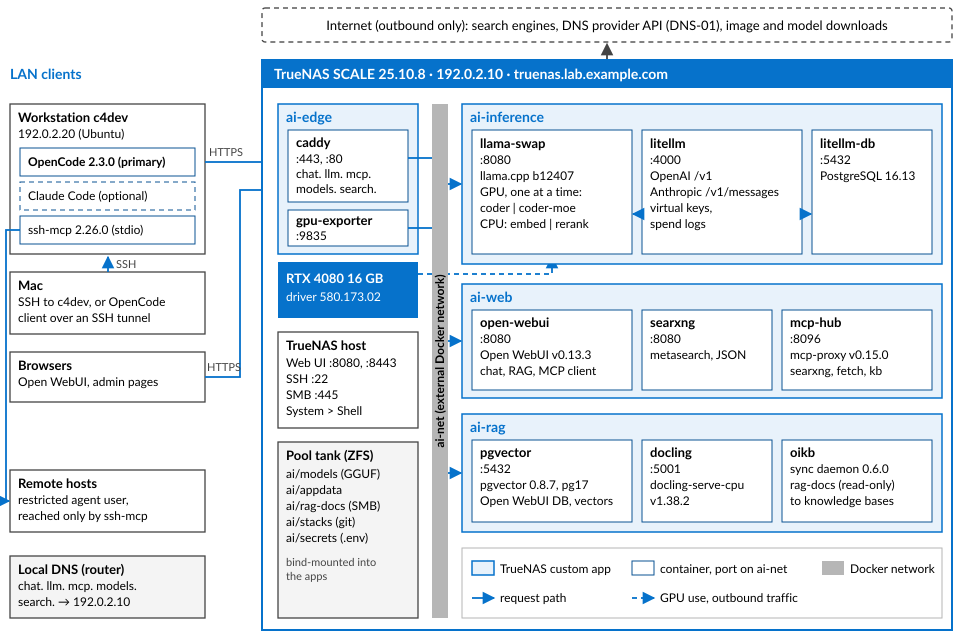

title: Introduction

# Introduction

This guide describes how to plan, deploy, validate and operate the Local Agent Stack: a self-hosted
coding agent that works like Claude Code but runs on open-weight models served from your own
TrueNAS SCALE server with one NVIDIA GPU. The guide follows the deployment from an empty TrueNAS
system to a working agent on a Linux workstation, and ends each procedure with a step that verifies
the result.

The files that the guide tells you to install are in the project repository, under `stack/` and
`clients/`. The guide quotes them.

!!! note
    If a command or a file in this guide differs from the file in the repository, the file in the
    repository is correct. Use the repository version and report the difference as an issue.

## Stack overview

The Local Agent Stack replaces the hosted parts of Claude Code with services that run on your LAN.
Models, retrieval and tools run locally; only web search, certificate issuance and downloads leave
the LAN. There is no cloud fallback for inference.

The stack provides:

- **Local models.** Qwen3.8-27B, fully resident on an RTX 4080 16 GB, is the main agent model. A
  faster mixture-of-experts profile (Qwen3.6-35B-A3B) can replace it on demand. llama.cpp serves the
  models; llama-swap starts and stops them.
- **One API endpoint.** LiteLLM serves the OpenAI format (`/v1/...`) and the Anthropic format
  (`/v1/messages`) at `https://llm.lab.example.com`, with one key per client.
- **A terminal coding agent.** OpenCode 2.3.0 runs on the workstation `c4dev` with sub-agents,
  commands, a guard plugin and MCP tools. Claude Code itself can use the same endpoint as a second,
  unsupported path.
- **A web GUI.** Open WebUI at `https://chat.lab.example.com` for chat, retrieval over your
  documents and web search.
- **Retrieval over your documents (RAG).** Files you copy to an SMB share are parsed, embedded and
  indexed. The web GUI and the coding agent query the same index.
- **Web search.** A self-hosted SearXNG instance.
- **Tools.** An MCP hub serves search, page fetch and knowledge-base tools to every client. A
  separate SSH tool on the workstation reaches remote hosts under a deny-by-default policy.
- **TLS.** Caddy terminates HTTPS for every host name with certificates obtained through the
  DNS-01 challenge for your own domain.

### Intended audience

This guide is for the administrator of a home lab or small lab who:

- administers TrueNAS SCALE through its web interface and shell;
- is familiar with the Linux shell, Docker Compose and git;
- owns a domain whose DNS provider offers an API;
- uses, or wants to use, a terminal coding agent.

### Limits of the stack

- **Model quality.** The local models are much smaller than Claude. They handle single tool calls
  well but fail more often on long, multi-step tasks. Plan the work around that; see
  [Where local models fall short](#where-local-models-fall-short).
- **One GPU model at a time.** The 16 GB card holds one agent model. Switching between the default
  and the fast profile reloads the model, and concurrent agents share the GPU. Plan for two to three
  agents working at the same time.
- **LAN only.** The design publishes no service to the internet and offers no remote access.
- **No cloud fallback.** If the server is down, the agent is down.

### Stack architecture

The stack runs as four TrueNAS custom apps. Each app is a compose file in the repository, installed
through **Install via YAML**. All apps join one external Docker network, `ai-net`, and reach each
other by container name. Only `caddy` publishes ports on the server.

<figure markdown><figcaption>Figure: Stack architecture</figcaption></figure>

Table: TrueNAS apps of the stack

| App | Services (container names) | Role | GPU |
|---|---|---|---|
| `ai-inference` | `llama-swap`, `litellm`, `litellm-db` | Serves the models and the API endpoint, with keys and usage logs | `llama-swap` only |
| `ai-rag` | `pgvector`, `docling`, `oikb` | Stores documents and vectors, parses documents, syncs the document share | None |
| `ai-web` | `open-webui`, `searxng`, `mcp-hub` | Web GUI, web search, shared MCP tools | None |
| `ai-edge` | `caddy`, `gpu-exporter` | HTTPS for every host name, GPU metrics | `gpu-exporter` only |

A request from the coding agent follows this path: the workstation resolves
`llm.lab.example.com` to the server, `caddy` terminates TLS and forwards the request over `ai-net`
to `litellm`, which checks the client key and forwards it to `llama-swap`. `llama-swap` starts the
requested model if it is not loaded, and passes the request to that model's `llama-server` process.

The embedding and reranking models run on the CPU, so they never compete with the agent model for
VRAM. They stay loaded while the GPU model changes.

### Software components and versions

Table: Software components

| Component | Version | Role |
|---|---|---|
| TrueNAS SCALE | 25.10.8 "Goldeye" (minimum 25.10.6) | Server operating system and app platform |
| NVIDIA driver | 580.173.02, shipped with TrueNAS (CUDA 13.0 maximum) | GPU driver and container toolkit |
| llama-swap with llama.cpp | `ghcr.io/mostlygeek/llama-swap:v273-cuda-b12407` (llama.cpp b12407, CUDA 12.8) | Model server and model switching |
| LiteLLM | v1.108.8, pinned by digest | API gateway |
| PostgreSQL | 16.13 | LiteLLM keys and usage logs |
| Open WebUI | v0.13.3, slim image | Web GUI and RAG |
| pgvector | `pgvector/pgvector:0.8.7-pg17` | Open WebUI database and vector store |
| docling-serve | `docling-serve-cpu` v1.38.2 | Document parsing |
| oikb | 0.6.0 | Sync of the document share into Open WebUI |
| SearXNG | 2026.11.15-2d500cb6b | Web search |
| mcp-proxy | v0.15.0 | MCP hub |
| Caddy | Built with DNS provider modules by the project's CI; tag in `stack/edge/compose.yaml` | Reverse proxy and certificates |
| OpenCode | 2.3.0 | Coding agent on the workstation |
| ssh-mcp | 2.26.0 | SSH tool on the workstation |

!!! note
    The compose files pin every image by tag and digest. Container images built for CUDA newer than
    13.0 do not start with the driver that TrueNAS 25.10 ships; the stack uses CUDA 12.8 images for
    that reason.

### Models and client-facing names

Clients never address a model file directly. They use the LiteLLM names in the last column, so a
model can be replaced on the server without changing any client.

Table: Models served by the stack

| Model | llama-swap id | Runs on | LiteLLM names |
|---|---|---|---|
| Qwen3.8-27B, dense, 3.5 bits per weight | `coder` | GPU, 64K context | `local-coder`; `local-fast` (thinking off); `local-opus`, `local-sonnet`, `local-haiku` (Claude Code) |
| Qwen3.6-35B-A3B, mixture of experts | `coder-moe` | GPU, experts of 16 layers in system RAM | `local-coder-moe` |
| Qwen3-Embedding-0.6B | `embed` | CPU | `local-embed` |
| Qwen3-Reranker-0.6B | `rerank` | CPU | `local-rerank` |

### Files that accompany this guide

Table: Repository layout

| Directory | Contents |
|---|---|
| `stack/` | One directory per app (`inference`, `rag`, `web`, `edge`): the compose file, its configuration files and an `<app>.env.example` that documents every variable |
| `clients/` | OpenCode configuration, agents, commands and the guard plugin; Claude Code settings; the ssh-mcp policy example; memory-file templates; `install.sh` |
| `tools/` | `secrets.py` (generates the secrets files), `deploy.py` (plan, apply and drift checks against TrueNAS), `smoke.py` and `bench.sh` (validation), `check.sh` (repository checks) |
| `guide/` | The source of this guide |
| `docs/` | The design contract and the research notes, with their sources |

### Deployment sequence

Table: Deployment sequence

| Step | Task | Chapter |
|---|---|---|
| 1 | Check the hardware, choose names and collect accounts and tokens | 2, Planning the deployment |
| 2 | Enable the GPU, cap the ZFS ARC, create datasets and the document share, move the TrueNAS UI ports, create `ai-net`, clone the repository, create the secrets | 3, Preparing TrueNAS SCALE |
| 3 | Download the models and install `ai-inference` | 4, Deploying the inference app |
| 4 | Install `ai-rag` and `ai-web`, then complete the Open WebUI first-run settings | 5, Deploying the RAG and web apps |
| 5 | Add DNS records, install `ai-edge` and obtain certificates | 6, Deploying the edge app |
| 6 | Install and configure OpenCode and the MCP tools on the workstation | 7, Configuring the coding agent |
| 7 | Set up project memory, agents and the GitHub workflow | 8, Running projects with agents |
| 8 | Run the smoke tests, benchmarks and evaluations | 9, Validating the deployment |

Chapters 10 to 12 cover operation, troubleshooting and removal.

## How the stack maps to Claude Code

Each part of Claude Code has a local counterpart. The harness features carry over almost
unchanged; the models are where the stack differs most.

Table: Claude Code and its local counterparts

| Claude Code | This stack |
|---|---|
| Claude models (Opus, Sonnet, Haiku) | Qwen3.8-27B through LiteLLM (`local-coder`, `local-fast`) |
| Anthropic API | LiteLLM at `https://llm.lab.example.com`, OpenAI and Anthropic formats |
| Claude Code CLI | OpenCode 2.3.0; Claude Code itself as an optional second path |
| `CLAUDE.md` memory files | `AGENTS.md`, from the templates in `clients/templates/` |
| Sub-agents | OpenCode agents `coordinator`, `researcher`, `builder` and `reviewer` |
| Slash commands | `/plan`, `/issue`, `/pr` and `/check` |
| Hooks | The OpenCode plugin `guard.ts` |
| WebSearch and WebFetch | SearXNG and fetch tools on the MCP hub; OpenCode's `webfetch` |
| MCP servers | The MCP hub at `https://mcp.lab.example.com`, and `ssh-mcp` on the workstation |
| No equivalent | Retrieval over your documents, in Open WebUI and through the `kb` tool |

Appendix C compares the features one by one, rates the parity of each, and describes where local
models fall short and how the stack mitigates it.

## Terminology

Table: Terminology

| Term | Definition |
|---|---|
| `ai-net` | The external Docker network that every app of the stack joins. Containers reach each other on it by name. |
| AMX | Advanced Matrix Extensions: matrix instructions of Intel Sapphire Rapids processors. llama.cpp uses them for dense CPU work such as embeddings and reranking, not for decoding with offloaded experts. |
| ARC | Adaptive Replacement Cache: the ZFS read cache in system RAM. The stack caps it so that the models keep their share of memory. |
| Compaction | The agent's summary of older conversation turns, written when the context window fills up. |
| Context window | The number of tokens a model processes in one request: prompt, history, tool results and output. The `coder` model runs with 65,536 tokens. |
| Custom app | A TrueNAS app installed from YAML through **Install via YAML**. Each app of the stack is a short YAML file that includes a compose file from the repository. |
| Dataset | A ZFS file system inside a pool, with its own properties, permissions and snapshots. |
| Decode | Generation of output tokens, one at a time. Its speed is limited by memory bandwidth. |
| DNS-01 | An ACME challenge that proves control of a domain through a DNS TXT record. It lets Caddy obtain trusted certificates for host names that are only reachable on the LAN. |
| Embedding | A vector that represents the meaning of a text passage. Similar passages have nearby vectors, which makes semantic search possible. |
| Expert offload | Keeping the expert weights of some layers of a mixture-of-experts model in system RAM (`--n-cpu-moe`), so that a model larger than the VRAM can run. |
| GGUF | The single-file model format of llama.cpp: quantized weights plus the metadata and chat template. |
| Harness | The program around a model that runs the agent loop: tools, permissions, memory files and sub-agents. OpenCode and Claude Code are harnesses. |
| KV cache | The attention keys and values that a model keeps for every token in its context. Its size grows with the context length; the stack stores it at `q8_0`. |
| llama.cpp | An open-source inference engine for GGUF models. Its `llama-server` program serves OpenAI- and Anthropic-format APIs. |
| llama-swap | A proxy that starts and stops `llama-server` processes on demand, keeps one GPU model loaded at a time and keeps the CPU models running. |
| LiteLLM | An API gateway that serves both API formats under one address, with virtual keys, rate limits and usage logs. |
| MCP | Model Context Protocol: an open protocol that connects agents to tool servers, over stdio or Streamable HTTP. |
| MCP hub | The `mcp-hub` container (`mcp-proxy`), which serves several stdio MCP servers over HTTP at `/servers/<name>/mcp` behind one bearer token. |
| MoE | Mixture of experts: a model architecture that activates only a few expert sub-networks per token. Qwen3.6-35B-A3B has 35 billion parameters, of which about 3 billion are active per token. |
| MTP | Multi-token prediction: a model head that drafts several tokens ahead, which llama.cpp uses for speculative decoding to raise decode speed. |
| OpenCode | An open-source (MIT) terminal coding agent, used as the main harness of the stack. |
| Open WebUI | A self-hosted web interface for chat, retrieval over documents, web search and MCP tools. |
| pgvector | A PostgreSQL extension that stores vectors and searches them. Open WebUI uses it for the document index. |
| Prefill | Processing of the input tokens before the first output token. A long first prompt takes seconds to tens of seconds. |
| Quantization | Storing model weights or the KV cache with fewer bits per value. The `coder` model uses about 3.5 bits per weight. |
| RAG | Retrieval-augmented generation: searching your documents and passing the best passages to the model with the question. |
| Reranker | A model that scores each retrieved passage against the query, so that only the most relevant passages reach the context. |
| SearXNG | A self-hosted metasearch engine that queries public search engines and returns the results as HTML or JSON. |
| VRAM | Memory on the GPU. The RTX 4080 has 16 GB, which decides which models and context lengths fit. |

## Revision history

Table: Revision history

| Revision | Date | Description |
|---|---|---|
| A00 | November 2026 | Initial release. |
